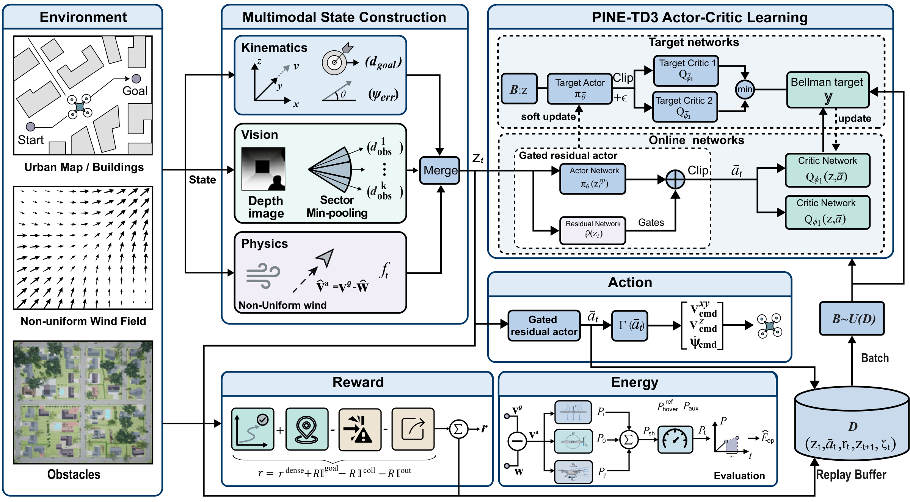

# PINE

Code for our paper, *PINE: A Physics-Informed Navigation Framework for Energy-Efficient Quadrotor Autonomy*.

We propose PINE for energy-efficient quadrotor navigation in spatially non-uniform wind. Our framework combines wind-aware multimodal observations, a gated residual actor, and adaptive spatial–physical value estimation. We instantiate PINE on TD3 and SAC and evaluate navigation reliability and model-based energy consumption in AirSim.



## Experiment code and data

| Path | Contents |
| --- | --- |
| `scripts/utils/` | PINE-TD3 and PINE-SAC policies |
| `gym_env/` | Navigation environment, wind sensing, dynamics, and energy estimation |
| `scripts/train.py`, `scripts/core/` | Training entrypoint and training utilities |
| `configs/`, `airsim_settings/` | Experiment and simulator settings |

The [main experiment summary](data/README.md) covers six learning-based methods evaluated on 200 matched scenarios per method. The [summary results](data/main/summary.csv) report success rates and successful-episode reward, steps, energy, and speed statistics.

## How to run

Use Python 3.8 and install the dependencies:

```bash
git clone https://github.com/ZhangYH321/PINE.git
cd PINE
python -m pip install -r requirements.txt
python -m pip install -r requirements-airsim.txt
```

Copy `airsim_settings/settings_multirotor.json` to `%USERPROFILE%\Documents\AirSim\settings.json`, then start the NH_center scene in AirSim.

Train PINE-TD3 from the repository root:

```bash
python scripts/train.py
```

For PINE-SAC, copy `configs/config_NH_center_SimpleMultirotor_3D.ini` to `configs/pine_sac.ini`, set `algo = SAC`, and run:

```bash
python scripts/train.py --config configs/pine_sac.ini
```
